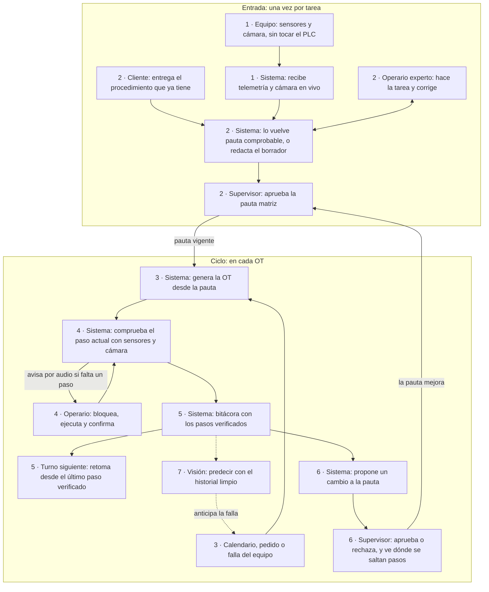

# Flujo de la solución

> La ejecución verificada es la bitácora. Seis pasos en el alcance, un séptimo como visión y cuatro actores. Estado del flujo completo: `Candidata a validar`.

El flujo se cuenta con el caso de uso, el mantenimiento de maquinaria; vale igual para cualquier flujo operacional ([ADR-0009](../decisions/0009-flujo-operacional-verificable-mantenimiento-como-caso-de-uso.md)). Los números entre paréntesis remiten a [REFERENCIAS](../projects/research/REFERENCIAS.md). El flujo incorpora el [planteamiento del equipo del 2026-11-21](../domain/fuentes/2026-11-21-planteamiento-del-equipo.md). Las líneas punteadas son visión, fuera del alcance del demo.

## 1. Conectar sin integrar

Sensores inalámbricos pegados al equipo y la cámara del operario. Nada toca el PLC ni la red de control. El archivo exportado de OT históricas solo hace falta para la visión del paso 7.

- **Evidencia.** Aqueveque et al. pusieron acelerómetros inalámbricos en bulldozers, palas y retroexcavadoras sin tocar su control, y clasificaron la salud del equipo con 85% a 95% de exactitud (24). `Confirmada`.
- **Construcción.** Partir con una fuente de cada tipo: un sensor y la cámara del celular. Un adaptador por fuente se justifica cuando llegue la segunda faena.
- **Leer.** (24). Además ISO 13374 y MIMOSA OSA-CBM, sin enlace verificado.
- **Por decidir.** Quién autoriza instalar un sensor y una cámara en la faena, y cuánto demora. `Brecha`.

## 2. Identificar y estandarizar

Hay dos entradas. Si el cliente ya tiene el procedimiento, que es el cliente objetivo, el sistema lo carga y lo vuelve una pauta comprobable: cada paso declara qué evidencia lo cierra. Si no lo tiene, un técnico experto hace la tarea con la cámara, el sistema redacta un borrador, el experto lo corrige y el supervisor lo aprueba.

- **Evidencia.** Un VLM sin entrenar describió por su cuenta el 54,6% de las fases de un montaje, y el 68% cuando se le dio la pauta correcta. Alcanza para un borrador, no para una pauta. Sus descripciones libres sí recogen ajustes e inspecciones que el experto hace sin decirlos (9). `Confirmada`.
- **Construcción.** El modelo redacta y pregunta; el experto corrige. La cámara cenital cubrió más fases que la frontal: 80% frente a 56% (9). El planteamiento del equipo habla de entregar el protocolo tras una ejecución observada; con esa evidencia, lo que sale de una ejecución es el borrador.
- **Leer.** (9), (15), (16), (21), (27) y (1).
- **Por decidir.** Cuántas repeticiones del experto hacen falta para confiar en la pauta. Quién decide, paso por paso, qué evidencia cierra cada uno al cargar un procedimiento existente. `Brecha`.

## 3. Generar la OT

La OT es la instancia ejecutable de la pauta vigente: la tarea, el equipo, los pasos en orden y la evidencia que cierra cada uno. El sistema la genera desde la pauta cada vez que hay que ejecutar la tarea, y una persona la confirma. El disparo puede ser el calendario de una mantención preventiva, el pedido de alguien o una falla, como una correa transportadora que se detiene sin aviso o un sensor que sale de rango. Ver [ADR-0006](../decisions/0006-la-ot-nace-del-protocolo.md).

- **Evidencia.** O'Donncha et al. cruzan OT, sensores y FMEA, y ponen un verificador determinista entre el modelo y la respuesta (25). `Confirmada`.
- **Construcción.** La OT es una fila con un estado y la versión de la pauta que ejecuta. Para el disparo por falla del demo basta un umbral sobre la vibración.
- **Leer.** (25), (26) y (29).
- **Por decidir.** Si una OT disparada por falla necesita pasos de diagnóstico que la pauta no trae, y quién la confirma: el supervisor o el operario. `Brecha`.

## 4. Ejecutar y verificar

El operario bloquea y etiqueta, y ejecuta paso a paso. Sensores y cámara comprueban el paso actual, y el operario confirma. Si se salta un paso, el sistema le avisa en el momento por un auricular, para que lo corrija ahí y no después.

- **Evidencia.** Sabetta et al. midieron un VLM general sobre videos completos de montaje. Detectó 12 de 12 pasos saltados, pero solo 3 de 12 cambios de orden y 0 de 12 acciones fuera de la pauta, y rechazó 5 de 12 ejecuciones correctas. Es un solo modelo, cuatro montajes en mesa y cámaras fijas (9; ver la [nota](../projects/research/notas/2026-sabetta-gemini-robotics-er.md)). `Confirmada`.
- **Construcción.** El orden lo impone la aplicación, que pregunta por un paso a la vez; no se le pide al modelo juzgar el video entero. Cada paso se comprueba por su estado final visible, como el candado puesto. Con 5 falsas alarmas en 12, al principio el sistema avisa y no bloquea. Ver [ADR-0002](../decisions/0002-la-aplicacion-impone-el-orden-de-la-pauta.md). El orden del bloqueo, que es donde el modelo falla, lo dan los sensores con su marca de tiempo: energía cortada antes de abrir la guarda. Y el aviso por audio que interrumpe sale solo de esa capa mientras no se mida la tasa de falsas alarmas de la cámara. Ver [Capas de verificación](#capas-de-verificación).
- **Leer.** (9), (10), (11), (12), (13), (14), (18), (20), (22) y (23). Para el aviso en el momento, (11) y (12).
- **Por decidir.** Qué pasos de una tarea real tienen una señal de sensor disponible, la latencia del aviso, si el auricular funciona con la protección auditiva y el ruido de una planta, y qué pasa sin conectividad. `Brecha`.

## 5. Bitácora y relevo de turno

La bitácora no se escribe: es la lista de pasos verificados con su evidencia. El operario solo confirma. Cuando el trabajo dura más de un turno, el siguiente lo retoma desde el último paso verificado, sin depender de quien se fue.

- **Evidencia.** Los errores al registrar OT son sistemáticos y cambian el resultado (3), (4). Con sugerencias del sistema y confirmación humana, el etiquetado tomó 88% menos tiempo, aunque con menos exactitud que el de un experto (8). `Confirmada`.
- **Construcción.** Una tabla de pasos verificados que solo admite agregar filas, con la evidencia y quién confirmó. La OT cerrada se arma desde esa tabla. El relevo es una lectura de la misma tabla: qué pasos están cerrados, con qué evidencia, y cuál sigue. El resumen redactado por un modelo va encima de eso, no en su lugar.
- **Leer.** (3), (4), (2), (8), (7) y (6). Además ISO 14224, sin enlace verificado.
- **Por decidir.** Qué evidencia exige una auditoría (foto, video o firma) y cuánto tiempo se guarda. El formato del relevo: resumen, consultas o *briefing*. No se buscó literatura sobre relevo de turno. `Brecha`.

## 6. Mejorar la pauta

Las desviaciones que se repiten se vuelven una propuesta de cambio a la pauta matriz. El supervisor aprueba o rechaza. El mismo dato le muestra en qué áreas y en qué pautas se saltan más pasos, para supervisar en persona solo los trabajos de mayor riesgo.

- **Evidencia.** Muchas desviaciones nacen de la presión de la jefatura y de pautas mal hechas, no del operario (33). Plant Memory reconoce que sus cambios se auditan, pero no se versionan ni se revierten (7). `Confirmada`.
- **Construcción.** Cada pauta lleva número de versión y cada OT guarda cuál ejecutó. El sistema propone y una persona aprueba. La vista del supervisor agrupa por pauta y por área antes que por persona: un paso que se saltan muchos operarios que normalmente cumplen apunta a la pauta. En un paso de seguridad, que se salte seguido no lo vuelve prescindible.
- **Leer.** (33), (34), (35), (28), (25) y (7).
- **Por decidir.** Cuándo una desviación es error del operario y cuándo es una pauta mala. `Brecha`.

## 7. Predecir (visión)

Fuera del alcance del demo y del pitch, salvo como una línea de hacia dónde va ([registro de decisiones](../decisions/decisions.md)). Con historia limpia por equipo, el sistema podría anticipar la falla y disparar la OT antes de que ocurra. La detección de anomalías de la capa 2 sí está en el alcance; la vida útil remanente no.

- **Evidencia.** Aqueveque et al. alertaron entre 120 y 170 horas antes en maquinaria minera móvil (24). Los modelos fundacionales de series de tiempo prometen detectar anomalías sin entrenar por equipo (31), (32), pero no encontramos ninguno probado en esta maquinaria. `Brecha`.
- **Construcción.** Es lo último. Sale de los pasos verificados más la telemetría, así que depende de que los pasos 4 y 5 funcionen.
- **Leer.** (24), (26), (31) y (32). Además ISO 13381-1, sin enlace verificado.
- **Por decidir.** Cuántas fallas reales por equipo hacen falta para prometer vida útil remanente. `Brecha`.

## Capas de verificación

Cada paso se comprueba con la primera capa que puede decidirlo. `Candidata a validar`; ver [ADR-0004](../decisions/0004-verificacion-por-capas.md).

| Capa | Qué decide | Ejemplo |
|---|---|---|
| 1 · Determinista: sensores y reglas | El orden y todo lo que un sensor mide | La energía se cortó antes de abrir la guarda |
| 2 · Aprendizaje automático sobre señales y sobre la imagen | Anomalías en vibración o temperatura, y el objeto que un detector ve con certeza | La correa vibra distinto que ayer, con algoritmo por definir. El detector ve el dispositivo de bloqueo en cada detección reciente |
| 3 · VLM por API | Lo que solo se ve o se redacta | El candado y la tarjeta están puestos; el resumen del relevo |

## Demo propuesto

`Confirmada` por el equipo el 2026-11-21; ver [ADR-0010](../decisions/0010-demo-brazo-robotico-en-una-celda-con-corte-local.md). Un brazo robótico con pinza, dentro de una caja que simula la celda de trabajo. Se ve peligroso sin explicarlo, y el sistema ayuda a que no lo sea.

**La celda.**

| Pieza | Qué hace en el demo | Estado |
|---|---|---|
| Brazo impreso con servos y pinza | La máquina: mueve piezas en ciclo | Existe |
| ESP32 | Lee los sensores, los manda al servidor y corta la energía por su cuenta | Existe; falta que actúe |
| Ultrasonido en la entrada de la caja | Marca la zona ocupada cuando alguien se acerca | Existe |
| Relé en la alimentación de los servos | Corta la energía, y su estado es el sensor de energía | Falta |
| Pulsador en el bloqueo | Marca que el bloqueo está puesto | El pulsador existe; falta montarlo |
| Cámara cenital (el celular) | Confirma los pasos que se ven, como el ajuste de la pinza | Existe; falta que el detector reconozca la pinza y la herramienta |
| Pantalla y voz | Muestran la OT y le hablan al operario | La pantalla existe; la voz está en la rama de Daniel |

**El guion.**

1. **El brazo trabaja y se ve peligroso.** Gira y abre y cierra la pinza. En pantalla, sus sensores en vivo.
2. **Falla:** suelta la pieza. Factum detecta la falla, abre la OT desde el protocolo y le dice al operario: «OT abierta: ajuste de pinza. Primer paso: corta la energía».
3. **El operario se salta ese paso y se acerca con el brazo energizado.** Es el momento del demo. El ESP32 ve la zona ocupada con energía viva y corta los servos, y Factum le habla: «Alto. El brazo tiene energía. Córtala y pon el bloqueo antes de acercarte». El brazo se detiene frente al jurado.
4. **Factum lo guía.** Corta la energía y pone el bloqueo, y cada paso lo cierra su sensor. Ajusta la pinza mientras la voz le dicta el paso, y la cámara lo confirma. Si duda, pregunta en voz alta y el modelo responde mirando la cámara. Retira el bloqueo, devuelve la energía y el brazo vuelve a trabajar bien. En pantalla queda la bitácora: la falla, el intento peligroso, el corte y cada paso con su evidencia.

La frase para el pitch: **Factum no reemplaza la seguridad de la máquina: hace que se cumpla.** El corte que hace el ESP32 se presenta como integración opcional; instalado sin integrarse, Factum avisa y guía.

Lo que no entra al demo y se cuenta en una frase: el relevo de turno y la propuesta de cambio a la pauta. Si falta tiempo, el paso 4 se acorta; el 3 no se corta. Lo abierto está en [SEGUIMIENTO](../roadmap/SEGUIMIENTO.md).
