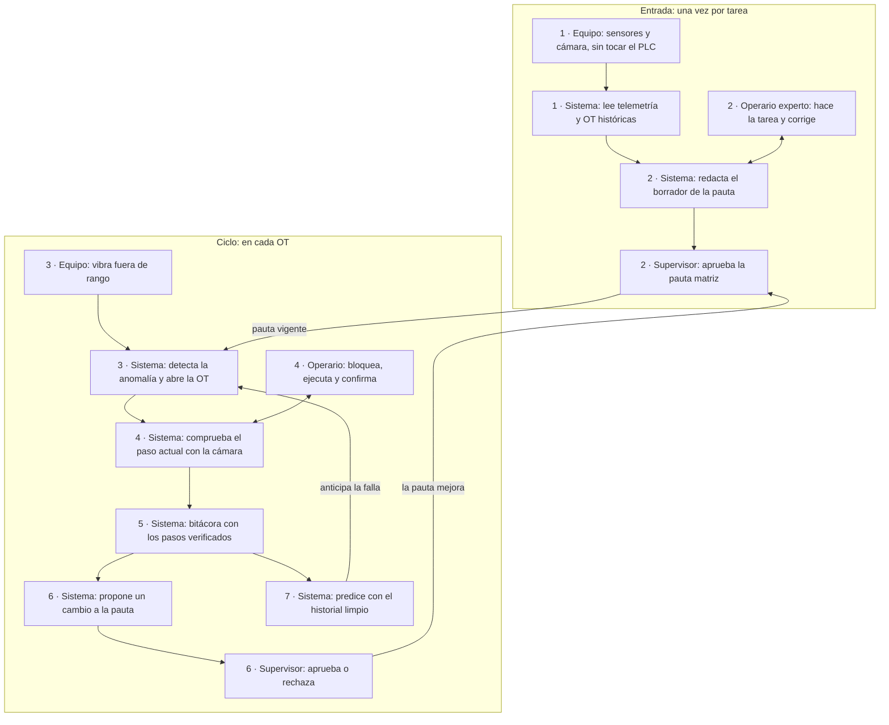

# Flujo de la solución

> La ejecución verificada es la bitácora. Siete pasos, cuatro actores. Estado del flujo completo: `Candidata a validar`.

Los números entre paréntesis remiten a [REFERENCIAS](../projects/research/REFERENCIAS.md).

## 1. Conectar sin integrar

Sensores inalámbricos pegados al equipo, la cámara del operario y el archivo exportado de OT. Nada toca el PLC ni la red de control.

- **Evidencia.** Aqueveque et al. pusieron acelerómetros inalámbricos en bulldozers, palas y retroexcavadoras sin tocar su control, y clasificaron la salud del equipo con 85% a 95% de exactitud (24). `Confirmada`.
- **Construcción.** Partir con una fuente de cada tipo: un sensor, un archivo de OT y la cámara del celular. Un adaptador por fuente se justifica cuando llegue la segunda faena.
- **Leer.** (24). Además ISO 13374 y MIMOSA OSA-CBM, sin enlace verificado.
- **Por decidir.** Quién autoriza instalar un sensor y una cámara en la faena, y cuánto demora. `Brecha`.

## 2. Identificar y estandarizar

Un técnico experto hace la tarea con la cámara. El sistema redacta un borrador de la pauta, el experto lo corrige y el supervisor lo aprueba.

- **Evidencia.** Un VLM sin entrenar describió por su cuenta el 54,6% de las fases de un montaje, y el 68% cuando se le dio la pauta correcta. Alcanza para un borrador, no para una pauta. Sus descripciones libres sí recogen ajustes e inspecciones que el experto hace sin decirlos (9). `Confirmada`.
- **Construcción.** El modelo redacta y pregunta; el experto corrige. La cámara cenital cubrió más fases que la frontal: 80% frente a 56% (9).
- **Leer.** (9), (15), (16), (21), (27) y (1).
- **Por decidir.** Cuántas repeticiones del experto hacen falta para confiar en la pauta. `Brecha`.

## 3. Detectar y abrir la OT

El sensor sale de rango. El sistema detecta la anomalía y abre la OT con la pauta vigente; una persona la confirma.

- **Evidencia.** O'Donncha et al. cruzan OT, sensores y FMEA, y ponen un verificador determinista entre el modelo y la respuesta (25). Aqueveque et al. alertaron entre 120 y 170 horas antes de la falla crítica (24). `Confirmada`.
- **Construcción.** La OT es una fila con un estado. Un umbral sobre la vibración basta para el primer disparo.
- **Leer.** (25), (26), (29) y (24).
- **Por decidir.** Si conviene buscar OT parecidas por palabra clave o por similitud. Se prueba en una tarde con OT reales. `Brecha`.

## 4. Ejecutar y verificar

El operario bloquea y etiqueta, y ejecuta paso a paso. La cámara comprueba el paso actual y el operario confirma.

- **Evidencia.** Sabetta et al. midieron un VLM general sobre videos completos de montaje. Detectó 12 de 12 pasos saltados, pero solo 3 de 12 cambios de orden y 0 de 12 acciones fuera de la pauta, y rechazó 5 de 12 ejecuciones correctas. Es un solo modelo, cuatro montajes en mesa y cámaras fijas (9; ver la [nota](../projects/research/notas/2026-sabetta-gemini-robotics-er.md)). `Confirmada`.
- **Construcción.** El orden lo impone la aplicación, que pregunta por un paso a la vez; no se le pide al modelo juzgar el video entero. Cada paso se comprueba por su estado final visible, como el candado puesto. Con 5 falsas alarmas en 12, al principio el sistema avisa y no bloquea. Ver [ADR-0002](../decisions/0002-la-aplicacion-impone-el-orden-de-la-pauta.md).
- **Leer.** (9), (10), (11), (12), (13), (14), (18), (20), (22) y (23).
- **Por decidir.** Cómo comprobar el orden del bloqueo, que es justo donde el modelo falla, y qué pasa sin conectividad. `Brecha`.

## 5. Bitácora

La bitácora no se escribe: es la lista de pasos verificados con su evidencia. El operario solo confirma.

- **Evidencia.** Los errores al registrar OT son sistemáticos y cambian el resultado (3), (4). Con sugerencias del sistema y confirmación humana, el etiquetado tomó 88% menos tiempo, aunque con menos exactitud que el de un experto (8). `Confirmada`.
- **Construcción.** Una tabla de pasos verificados que solo admite agregar filas, con la evidencia y quién confirmó. La OT cerrada se arma desde esa tabla.
- **Leer.** (3), (4), (2), (8), (7) y (6). Además ISO 14224, sin enlace verificado.
- **Por decidir.** Qué evidencia exige una auditoría (foto, video o firma) y cuánto tiempo se guarda. `Brecha`.

## 6. Mejorar la pauta

Las desviaciones que se repiten se vuelven una propuesta de cambio a la pauta matriz. El supervisor aprueba o rechaza.

- **Evidencia.** Muchas desviaciones nacen de la presión de la jefatura y de pautas mal hechas, no del operario (33). Plant Memory reconoce que sus cambios se auditan, pero no se versionan ni se revierten (7). `Confirmada`.
- **Construcción.** Cada pauta lleva número de versión y cada OT guarda cuál ejecutó. El sistema propone y una persona aprueba.
- **Leer.** (33), (34), (35), (28), (25) y (7).
- **Por decidir.** Cuándo una desviación es error del operario y cuándo es una pauta mala. `Brecha`.

## 7. Predecir

El primer día detecta anomalías. La vida útil remanente llega cuando hay historia limpia por equipo.

- **Evidencia.** Aqueveque et al. alertaron entre 120 y 170 horas antes en maquinaria minera móvil (24). Los modelos fundacionales de series de tiempo prometen detectar anomalías sin entrenar por equipo (31), (32), pero no encontramos ninguno probado en esta maquinaria. `Brecha`.
- **Construcción.** Es lo último. Sale de los pasos verificados más la telemetría, así que depende de que los pasos 4 y 5 funcionen.
- **Leer.** (24), (26), (31) y (32). Además ISO 13381-1, sin enlace verificado.
- **Por decidir.** Cuántas fallas reales por equipo hacen falta para prometer vida útil remanente. `Brecha`.

## Demo propuesto

`Candidata a validar`. Una pasada completa del ciclo sobre un equipo de prueba chico, en vez de los cuatro pilares a medias:

1. Un motor o ventilador con un acelerómetro (ESP32 + MPU6050) transmite telemetría. En vivo se le agrega un peso para desbalancearlo.
2. El sistema detecta la anomalía y abre la OT con su pauta.
3. Alguien ejecuta la pauta con el celular como cámara. El sistema comprueba cada paso y guarda la evidencia. Si un paso se salta a propósito, el sistema lo marca: es el caso que un VLM general detecta bien (9).
4. La desviación se convierte en una propuesta de cambio a la pauta matriz, que una persona aprueba frente al jurado.

Depende de dos cosas abiertas en [SEGUIMIENTO](../roadmap/SEGUIMIENTO.md): si hay hardware a mano y si hay OT reales de alguna faena. Sin OT de faena, el corpus histórico puede salir de MaintIE (6).
