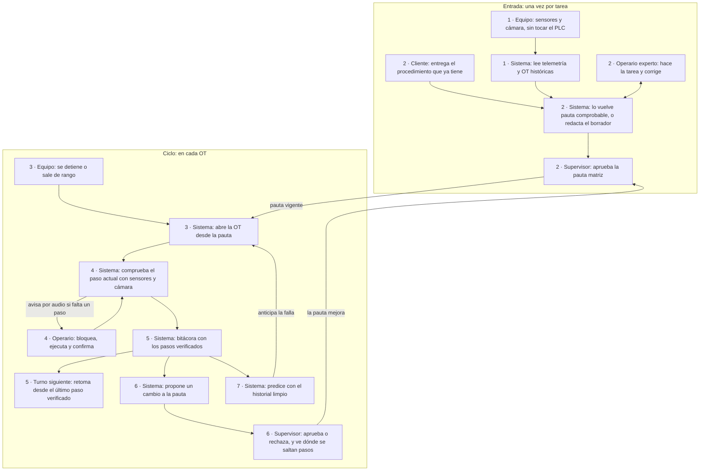

# Flujo de la solución

> La ejecución verificada es la bitácora. Siete pasos, cuatro actores. Estado del flujo completo: `Candidata a validar`.

Los números entre paréntesis remiten a [REFERENCIAS](../projects/research/REFERENCIAS.md). El flujo incorpora el [planteamiento del equipo del 2026-11-21](../domain/fuentes/2026-11-21-planteamiento-del-equipo.md).

## 1. Conectar sin integrar

Sensores inalámbricos pegados al equipo, la cámara del operario y el archivo exportado de OT. Nada toca el PLC ni la red de control.

- **Evidencia.** Aqueveque et al. pusieron acelerómetros inalámbricos en bulldozers, palas y retroexcavadoras sin tocar su control, y clasificaron la salud del equipo con 85% a 95% de exactitud (24). `Confirmada`.
- **Construcción.** Partir con una fuente de cada tipo: un sensor, un archivo de OT y la cámara del celular. Un adaptador por fuente se justifica cuando llegue la segunda faena.
- **Leer.** (24). Además ISO 13374 y MIMOSA OSA-CBM, sin enlace verificado.
- **Por decidir.** Quién autoriza instalar un sensor y una cámara en la faena, y cuánto demora. `Brecha`.

## 2. Identificar y estandarizar

Hay dos entradas. Si el cliente ya tiene el procedimiento, que es el cliente objetivo, el sistema lo carga y lo vuelve una pauta comprobable: cada paso declara qué evidencia lo cierra. Si no lo tiene, un técnico experto hace la tarea con la cámara, el sistema redacta un borrador, el experto lo corrige y el supervisor lo aprueba.

- **Evidencia.** Un VLM sin entrenar describió por su cuenta el 54,6% de las fases de un montaje, y el 68% cuando se le dio la pauta correcta. Alcanza para un borrador, no para una pauta. Sus descripciones libres sí recogen ajustes e inspecciones que el experto hace sin decirlos (9). `Confirmada`.
- **Construcción.** El modelo redacta y pregunta; el experto corrige. La cámara cenital cubrió más fases que la frontal: 80% frente a 56% (9). El planteamiento del equipo habla de entregar el protocolo tras una ejecución observada; con esa evidencia, lo que sale de una ejecución es el borrador.
- **Leer.** (9), (15), (16), (21), (27) y (1).
- **Por decidir.** Cuántas repeticiones del experto hacen falta para confiar en la pauta. Quién decide, paso por paso, qué evidencia cierra cada uno al cargar un procedimiento existente. `Brecha`.

## 3. Detectar y abrir la OT

El equipo se detiene sin aviso, como una correa transportadora, o un sensor sale de rango. El sistema abre la OT desde la pauta vigente; una persona la confirma.

- **Evidencia.** O'Donncha et al. cruzan OT, sensores y FMEA, y ponen un verificador determinista entre el modelo y la respuesta (25). Aqueveque et al. alertaron entre 120 y 170 horas antes de la falla crítica (24). `Confirmada`.
- **Construcción.** La OT es una fila con un estado. Un umbral sobre la vibración basta para el primer disparo.
- **Leer.** (25), (26), (29) y (24).
- **Por decidir.** Si conviene buscar OT parecidas por palabra clave o por similitud. Se prueba en una tarde con OT reales. `Brecha`.

## 4. Ejecutar y verificar

El operario bloquea y etiqueta, y ejecuta paso a paso. Sensores y cámara comprueban el paso actual, y el operario confirma. Si se salta un paso, el sistema le avisa en el momento por un auricular, para que lo corrija ahí y no después.

- **Evidencia.** Sabetta et al. midieron un VLM general sobre videos completos de montaje. Detectó 12 de 12 pasos saltados, pero solo 3 de 12 cambios de orden y 0 de 12 acciones fuera de la pauta, y rechazó 5 de 12 ejecuciones correctas. Es un solo modelo, cuatro montajes en mesa y cámaras fijas (9; ver la [nota](../projects/research/notas/2026-sabetta-gemini-robotics-er.md)). `Confirmada`.
- **Construcción.** El orden lo impone la aplicación, que pregunta por un paso a la vez; no se le pide al modelo juzgar el video entero. Cada paso se comprueba por su estado final visible, como el candado puesto. Con 5 falsas alarmas en 12, al principio el sistema avisa y no bloquea. Ver [ADR-0002](../decisions/0002-la-aplicacion-impone-el-orden-de-la-pauta.md). El orden del bloqueo, que es donde el modelo falla, lo dan los sensores con su marca de tiempo: energía cortada antes de abrir la guarda. Y el aviso por audio que interrumpe sale solo de esa capa mientras no se mida la tasa de falsas alarmas de la cámara. Ver [Capas de verificación](#capas-de-verificación).
- **Leer.** (9), (10), (11), (12), (13), (14), (18), (20), (22) y (23). Para el aviso en el momento, (11) y (12).
- **Por decidir.** Qué pasos de una tarea real tienen una señal de sensor disponible, la latencia del aviso, si el auricular funciona con la protección auditiva y el ruido de una planta, y qué pasa sin conectividad. `Brecha`.

## 5. Bitácora y relevo de turno

La bitácora no se escribe: es la lista de pasos verificados con su evidencia. El operario solo confirma. Cuando el trabajo dura más de un turno, el siguiente lo retoma desde el último paso verificado, sin depender de quien se fue.

- **Evidencia.** Los errores al registrar OT son sistemáticos y cambian el resultado (3), (4). Con sugerencias del sistema y confirmación humana, el etiquetado tomó 88% menos tiempo, aunque con menos exactitud que el de un experto (8). `Confirmada`.
- **Construcción.** Una tabla de pasos verificados que solo admite agregar filas, con la evidencia y quién confirmó. La OT cerrada se arma desde esa tabla. El relevo es una lectura de la misma tabla: qué pasos están cerrados, con qué evidencia, y cuál sigue. El resumen redactado por un modelo va encima de eso, no en su lugar.
- **Leer.** (3), (4), (2), (8), (7) y (6). Además ISO 14224, sin enlace verificado.
- **Por decidir.** Qué evidencia exige una auditoría (foto, video o firma) y cuánto tiempo se guarda. El formato del relevo: resumen, consultas o *briefing*. No se buscó literatura sobre relevo de turno. `Brecha`.

## 6. Mejorar la pauta

Las desviaciones que se repiten se vuelven una propuesta de cambio a la pauta matriz. El supervisor aprueba o rechaza. El mismo dato le muestra en qué áreas y en qué pautas se saltan más pasos, para supervisar en persona solo los trabajos de mayor riesgo.

- **Evidencia.** Muchas desviaciones nacen de la presión de la jefatura y de pautas mal hechas, no del operario (33). Plant Memory reconoce que sus cambios se auditan, pero no se versionan ni se revierten (7). `Confirmada`.
- **Construcción.** Cada pauta lleva número de versión y cada OT guarda cuál ejecutó. El sistema propone y una persona aprueba. La vista del supervisor agrupa por pauta y por área antes que por persona: un paso que se saltan muchos operarios que normalmente cumplen apunta a la pauta. En un paso de seguridad, que se salte seguido no lo vuelve prescindible.
- **Leer.** (33), (34), (35), (28), (25) y (7).
- **Por decidir.** Cuándo una desviación es error del operario y cuándo es una pauta mala. `Brecha`.

## 7. Predecir

El primer día detecta anomalías. La vida útil remanente llega cuando hay historia limpia por equipo.

- **Evidencia.** Aqueveque et al. alertaron entre 120 y 170 horas antes en maquinaria minera móvil (24). Los modelos fundacionales de series de tiempo prometen detectar anomalías sin entrenar por equipo (31), (32), pero no encontramos ninguno probado en esta maquinaria. `Brecha`.
- **Construcción.** Es lo último. Sale de los pasos verificados más la telemetría, así que depende de que los pasos 4 y 5 funcionen.
- **Leer.** (24), (26), (31) y (32). Además ISO 13381-1, sin enlace verificado.
- **Por decidir.** Cuántas fallas reales por equipo hacen falta para prometer vida útil remanente. `Brecha`.

## Capas de verificación

Cada paso se comprueba con la primera capa que puede decidirlo. `Candidata a validar`; ver [ADR-0004](../decisions/0004-verificacion-por-capas.md).

| Capa | Qué decide | Ejemplo |
|---|---|---|
| 1 · Determinista: sensores y reglas | El orden y todo lo que un sensor mide | La energía se cortó antes de abrir la guarda |
| 2 · Aprendizaje automático sobre señales | Anomalías en vibración o temperatura | La correa vibra distinto que ayer. Algoritmo por definir |
| 3 · VLM por API | Lo que solo se ve o se redacta | El candado y la tarjeta están puestos; el resumen del relevo |

## Demo propuesto

`Candidata a validar`. Una pasada completa del ciclo sobre una correa transportadora a escala, en vez de cada pieza a medias. El equipo tiene Arduino, Raspberry Pi, ESP, sensores y motores, y quiere una interfaz donde se vea llegar el protocolo, generarse la OT y al operario recibir ayuda cuando se equivoca.

1. Un motor mueve la correa. Un ESP lee vibración o temperatura, un interruptor que corta la energía y un sensor en la guarda.
2. La correa se detiene sin aviso. El sistema abre la OT desde la pauta, y la pantalla muestra el costo de cada hora detenida.
3. Alguien ejecuta la pauta con el celular como cámara y un auricular. Se salta el bloqueo a propósito y abre la guarda con la energía conectada: el sensor lo detecta y el aviso le llega al oído antes de que meta la mano. Es el momento del demo.
4. La cámara comprueba que el candado y la tarjeta están puestos. Cada paso verificado entra a la bitácora con su evidencia.
5. A mitad del trabajo cambia el turno: otra persona lo retoma desde el último paso verificado.
6. La desviación se convierte en una propuesta de cambio a la pauta matriz, que una persona aprueba frente al jurado, y la vista del supervisor muestra dónde se saltan pasos.

Si falta tiempo, se cortan primero los puntos 5 y 6; el 3 no se corta. Sin OT de faena, el corpus histórico puede salir de MaintIE (6). Lo abierto está en [SEGUIMIENTO](../roadmap/SEGUIMIENTO.md).
