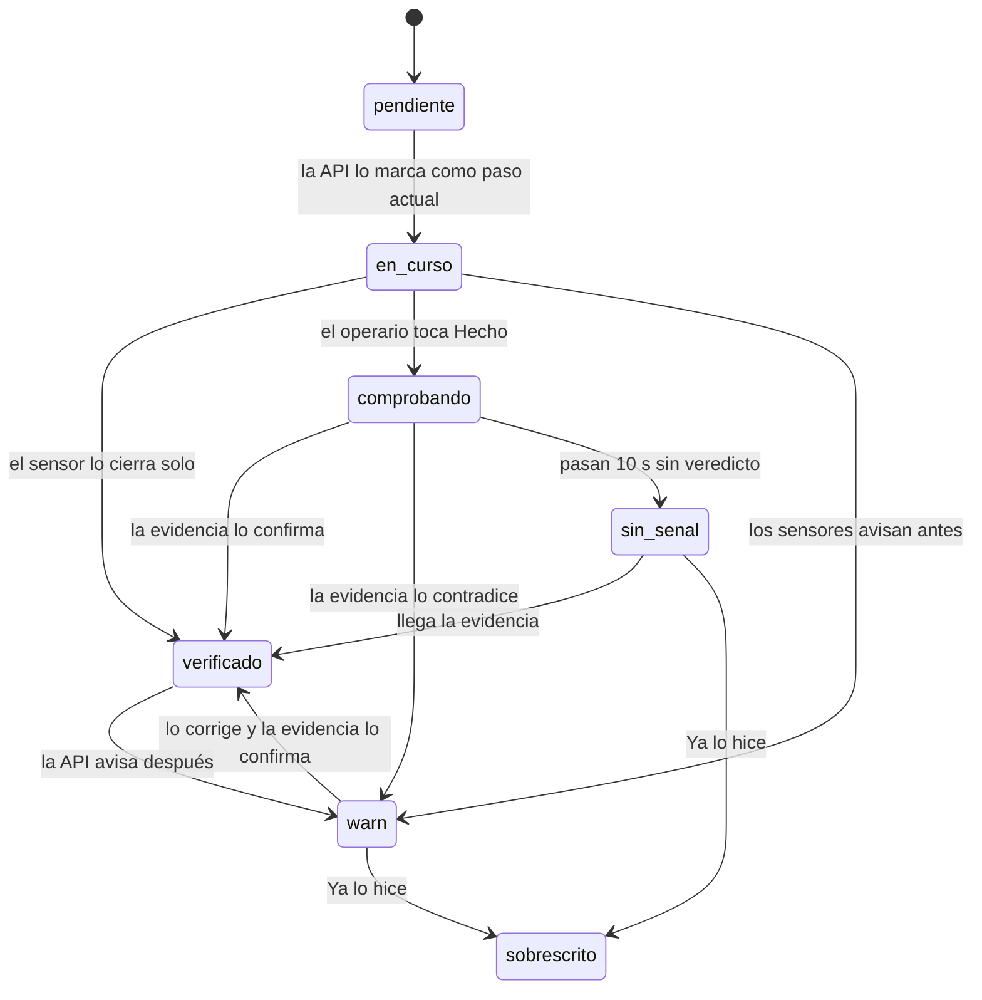

# Frontend — alcance y reparto

**Proyecto:** Factum — Platanus Hack 26
**Rama:** `feat/front-y-servicios`
**Módulo de Diego:** gestión y visualización de órdenes de trabajo (OT)
**Módulo de Dani:** ejecución de la OT, avisos y voz
**Estado:** acordado el 2026-11-21 para el MVP. Sale de la pizarra del equipo y de las respuestas de Dani. Lo marcado *(propuesta)* no se discutió: es una decisión razonable que cualquiera de los dos puede cambiar avisando.

## 1. Para qué

El demo tiene que mostrar esto: el supervisor asigna una OT, el operario la ejecuta paso a paso y, cuando la API detecta que un paso no se hizo, **el operario lo oye en el momento**. A mitad del trabajo cambia el turno y otro operario la termina desde donde quedó.

El front no verifica nada. Muestra lo que decide la API, deja al operario responder y hace sonar el aviso. La lógica de verificación es del equipo de Francisco.

## 2. Decisiones tomadas

| Tema | Decisión |
|---|---|
| Stack | Vite + React + TypeScript, en `web/`. Una sola app con pantallas separadas por ruta, no una sola pantalla |
| Login | Falso: se elige un usuario de una lista, sin contraseña. Uno real solo si sobra tiempo |
| Datos mientras no hay back | Un mock que imita la forma que la API ya devuelve (`GET /ot/{id}`), más las extensiones de la [sección 8](#8-contrato-con-la-api). El mock es solo para construir |
| Demo en vivo | Corre sobre el back real, con el supervisor en un computador y el operador en un celular. Los warns y la alerta de seguridad los disparan los sensores reales del ESP32 |
| Captura | El front no captura nada. La cámara y los sensores van por el dispositivo de borde, directo a la API |
| Relevo de turno | Entra al MVP. El reporte final y el conteo de warns por operario quedan en P1 |
| Botón «Ya lo hice» (el *skip* de la pizarra) | No sirve para saltarse trabajo. Aparece solo cuando la API avisa que un paso no se hizo, y el operario lo usa para decir que sí lo hizo: es un falso positivo. Funciona en cualquier paso, incluso los críticos. La palabra del operario manda, y la API registra la sobrescritura a su nombre como +1 warn |
| Aviso por voz | Cuando la API avisa que un paso no se hizo, el aviso se convierte en voz con ElevenLabs y suena en la app del operario casi al instante. Ver [sección 7](#7-aviso-por-voz-elevenlabs) |
| Endpoints que faltan | Los hacen Diego y Dani después de las pantallas, como capa de servicios, con lo mínimo. No se invierte tiempo en el back: el equipo de Francisco lo va a cambiar |
| Dispositivo | La app del operario se diseña para celular con audífonos, y el celular queda con la pantalla encendida y la app abierta durante todo el trabajo. La del supervisor se diseña para computador |

**Choque por resolver con el equipo de Francisco.** [LOGICA](./LOGICA.md) y la API desplegada dicen lo contrario de «Ya lo hice»: un paso en conflicto no se cierra, y un paso de sensor nunca se cierra hablando (regla 2 de `/agente`). Para el front manda «Ya lo hice», que decidió Dani. Falta acordar con ellos un evento de sobrescritura que cierre el paso a nombre del operario; mientras tanto, el mock lo imita.

## 3. Reparto

| Diego — Gestión | Dani — Ejecución |
|---|---|
| Login falso y sesión con rol | Vista de ejecución de la OT |
| Dashboard del supervisor | Máquina de estados del paso |
| Dashboard del operador | Warns, alerta de seguridad y botón «Ya lo hice» |
| Listado y display de OT | Aviso por voz con ElevenLabs |
| Asignar y reasignar operador | Entregar turno y briefing del que llega |
| Estado general de la OT (lo trae la API) | Pantalla de OT completa |
| Escenarios del mock de gestión | Base del mock y escenarios de ejecución |

Dani arma la base compartida de la sección 4 en el primer commit, y Diego parte sobre ella *(propuesta)*.

## 4. Base compartida

```
web/
  src/
    api/         tipos.ts y cliente.ts: el único lugar que sabe de la API
    mocks/       handlers de MSW y escenarios
    sesion/      usuario actual y rol
    gestion/     Diego: login, dashboards, listado
    ejecucion/   Dani: vista de la OT, máquina de estados, voz, briefing
```

| Ruta | Quién entra | Dueño |
|---|---|---|
| `/login` | todos | Diego |
| `/supervisor` | supervisor | Diego |
| `/operador` | operador | Diego |
| `/ot/:id` | el operador asignado | Dani |

- `api/` y `sesion/` son compartidos: se avisa antes de cambiarlos. Fuera de eso, cada uno trabaja en su carpeta y no hay choques en la rama.
- El id de la OT viaja en la URL y la sesión (`id`, `nombre`, `rol`) en `localStorage`. Con eso el módulo de ejecución sabe quién es el actor.
- Los actores usan el formato de la bitácora: `operario:1`, `supervisor:1`.
- Usuarios del demo: un supervisor y dos operadores, OP1 y OP2, como en la pizarra.
- El mock corre en el navegador con MSW, que también imita el WebSocket, y se activa con `VITE_MOCK=1`. Sin mock, el cliente apunta a `VITE_API_URL`, que en el demo es `https://34-176-44-192.sslip.io`.
- Dentro de un navegador, el mock es un solo mundo: lo que el supervisor asigna en `/supervisor` aparece en `/operador` y en `/ot/:id`. El escenario solo fija cómo parte ese mundo, y se elige en la URL: `/ot/ot-12?escenario=warn-sobrescrito`. No cruza dispositivos, y no hace falta: el demo corre sobre el back real.
- Los datos del mock usan la pauta real, [`datos/pauta-correa.json`](../../datos/pauta-correa.json): 6 pasos sobre la correa CT-01.

## 5. Diego — gestión

**Login falso.** Lista de usuarios; al elegir uno entra a su dashboard según el rol.

**Supervisor.** Ve todas las OT con su estado general, su operador y su avance. Asigna las que no tienen operador y reasigna las entregadas. Reasignar es P0: sin eso no hay relevo.

**Operador.** Ve solo sus OT y entra a una con «Comenzar» o «Continuar», que lleva a `/ot/:id`.

**Cada OT muestra:** id, nombre de la pauta, equipo, operador, estado general, avance (por ejemplo 3/6) y la acción según el rol. El avance y el estado los trae la API: el front no los calcula.

Estados generales *(propuesta)*:

| Estado | El supervisor ve | El operador ve |
|---|---|---|
| `sin_asignar` | «Asignar» | no aparece |
| `asignada` | el operador | «Comenzar» |
| `en_ejecucion` | el operador y el avance | «Continuar» |
| `entregada` | «Reasignar», con el avance y quién la entregó | ya no le aparece al que la entregó |
| `completa` | el avance final | «Ver resumen» |

## 6. Dani — ejecución

### La pantalla

```
┌──────────────────────────────┐
│ OT-12 · Correa CT-01   00:14 │
│ Cambio de rodillo        1/6 │
├──────────────────────────────┤
│ ✓ 1 Cortar energía y bloquear│
│ ✗ 2 Retirar la guarda        │
│   ⚠ El sensor no ve la guarda│
│     abierta                  │
│   [ Ya lo hice ]             │
│ · 3 Cambiar el rodillo       │
│ · 4 Reinstalar la guarda     │
├──────────────────────────────┤
│ [          Hecho           ] │
│              Entregar turno  │
└──────────────────────────────┘
```

### Estados de un paso



| Estado en pantalla | De dónde sale |
|---|---|
| `pendiente`, `en_curso` | `no_verificado` en la API; es `en_curso` si es el `paso_actual` |
| `comprobando`, `sin_senal` | Solo del front: el operario tocó «Hecho» y el veredicto no llega |
| `verificado` | `verificado` en la API |
| `warn` | `en_conflicto` en la API |
| `sobrescrito` | Estado nuevo en la API. Se ve distinto de `verificado`: cerrado por la palabra de OP1, no por la evidencia |

- **La API manda.** El front nunca cierra un paso ni decide el orden: muestra el `paso_actual` que le llega. Cuando el stream trae un `evento` con `paso_id`, el front vuelve a pedir `GET /ot/{id}` en vez de calcular el estado de los pasos.
- Un paso de sensor se cierra solo cuando llega la lectura: el operario no tiene que tocar nada. «Hecho» sirve sobre todo para los pasos de cámara y de confirmación, y llama a `POST /ot/{id}/declarar`.
- «Ya lo hice» llama a `POST /ot/{id}/sobrescribir`, con una nota opcional.
- Un warn puede caer en cualquier paso, no solo en el actual. La API dice en cuál.
- En `sin_senal` el front no inventa un warn ni lo hace sonar: solo muestra que no llega la señal y ofrece «Ya lo hice» *(propuesta: 10 s)*.

### Alerta de seguridad

«Guarda abierta con energía viva» no es un paso: llega en cualquier momento, vaya el operario en el paso que vaya. Se ve como un banner rojo arriba de todo, suena, y tiene las mismas dos salidas: corregirlo, y la API la resuelve sola cuando el sensor vuelve a estar bien (llega un evento `alerta_resuelta`), o «Ya lo hice», que queda registrado como sobrescritura.

El banner muestra `calificacion.avisos`: la lista de lo que está mal ahora, lo más grave primero. Un aviso existe mientras venga en esa lista.

### Qué suena y qué no

Suena lo que llega con nivel `error`, y solo la capa 1 (sensores y reglas) llega a `error`. Lo que dice la cámara (capa 3) y las anomalías de señal (capa 2) llegan a lo más a `warning`: se muestran pero no suenan, como fija [LOGICA](./LOGICA.md#qué-puede-interrumpir-al-operario). Con tantas falsas alarmas, un aviso que suena de más le enseña al operario a ignorarlo.

### Relevo de turno

1. OP1 toca «Entregar turno» y confirma. El front llama a `POST /ot/{id}/relevo/entregar` y vuelve a `/operador`.
2. El supervisor reasigna la OT a OP2 (Diego).
3. OP2 entra y ve el **briefing** antes de la ejecución: el resumen, qué pasos están cerrados y cómo (verificado o sobrescrito y por quién), los warns heredados y desde qué paso sigue. No hace falta endpoint: hay un relevo pendiente si el último `relevo_entregado` de la bitácora no tiene un `relevo_recibido` después, y el resumen viene en su `detalle`.
4. OP2 toca «Recibido». El front llama a `POST /ot/{id}/relevo/recibir` y abre la ejecución en el paso actual.

### OT completa

Pantalla de cierre con los pasos verificados, los sobrescritos y los warns. El reporte con KPIs de desempeño es P1.

### Si la API falla

Banner «Sin conexión, reintentando». Se mantiene el último estado conocido, los botones que escriben se deshabilitan y el WebSocket reintenta con espera creciente, volviendo con `?desde=`.

Un 409 trae en `regla` la regla de negocio que se violó: se le muestra al operario tal cual y no se reintenta igual.

## 7. Aviso por voz (ElevenLabs)

Cuando la API avisa que un paso no se hizo, el aviso se convierte en voz con ElevenLabs y suena en la app del operario casi al instante.

**Cómo llega:**

1. Al tocar «Comenzar» o «Continuar», el front abre la sesión (`POST /ot/{id}/sesion`) y se conecta a `wss://…/ot/{id}/stream`. Solo escucha. Si se corta, vuelve con `?desde=<último evento.id>`.
2. Cuando llega un mensaje `evento` nuevo cuya `calificacion.nivel` es `error`, el front pide el audio de su `detalle` a `GET /voz?texto=…` y lo reproduce mientras se descarga.
3. El `evento.id` es la llave: un evento suena una sola vez, también al reconectar. La bitácora que trae el snapshot al conectar **no** suena: es lo que ya pasó.
4. `/voz` es un endpoint nuestro que llama a ElevenLabs con una voz fija en español y devuelve el audio. Vive en su propio archivo, `app/voz.py`, para no chocar con los cambios del equipo de Francisco *(propuesta)*.

Por qué la voz sale del evento y no de `calificacion.avisos`: un aviso no trae `id` ni dice de qué paso es, así que no hay cómo saber si ya sonó. Y por qué el front pide la voz en vez de esperar que el back la adjunte: así la voz solo necesita un texto, y no depende de cómo el equipo de Francisco rehaga los eventos. Si después el back manda un `audio_url`, el front reproduce ese.

**Reglas:**

- La llave de ElevenLabs vive solo en el servidor, en `ELEVENLABS_API_KEY`. Nunca en el repo ni en el navegador: el repo es público.
- Meta: menos de 2 s desde que el evento entra a la bitácora hasta que suena *(propuesta)*. El stream lo entrega al instante, así que casi todo ese tiempo es de ElevenLabs.
- Los textos de los avisos del demo se generan una vez y se guardan, para que en el escenario suenen sin esperar a ElevenLabs.
- Si `/voz` falla, el front dice el mismo texto con la voz del navegador (`speechSynthesis`). El aviso nunca queda mudo.
- Si llegan dos eventos, suenan en orden, sin pisarse.
- Lo que se dice es el `detalle` del evento. El tono, como en la pizarra: «Oye, el candado no aparece puesto. Bloquea antes de seguir.» Si el `detalle` de la API suena muy técnico, se le pide al equipo de Francisco o se arma el texto en el front.
- El navegador del celular no reproduce sonido hasta que el usuario toca algo. El toque en «Comenzar» o «Continuar» desbloquea el audio, y la pantalla muestra si el audio está activo, con un botón «Probar audio». Probarlo en el celular del demo, sobre todo si es iPhone.
- Con la pantalla bloqueada, el celular corta el WebSocket y deja de sonar. La vista de ejecución le pide al navegador que mantenga la pantalla encendida (Wake Lock API) mientras la OT está abierta.
- Con el mock, la voz es la del navegador, salvo que `/voz` esté corriendo.

## 8. Contrato con la API

> El back va a cambiar con el equipo de Francisco. Esto es solo lo que el front consume, y todo cambio se absorbe en `web/src/api/` sin tocar las pantallas.

La API está desplegada en `https://34-176-44-192.sslip.io`. La guía completa está en [`/agente`](https://34-176-44-192.sslip.io/agente), los esquemas en `/openapi.json`, y el diseño en el [PRD de servicios en vivo](../projects/servicios-en-vivo/PRD.md) y el [ADR-0007](../decisions/0007-servicios-en-vivo-sesion-stream-y-calificacion.md). Sin autenticación: es un servidor de demo.

**Lo que el front usa y ya existe:**

| Qué | Para | Nota |
|---|---|---|
| `GET /ots` → `[{ot, pauta, version, equipo, abierta_en, paso_actual, completa}]` | Diego | El id viene en `ot`, no en `id`. No trae operador ni avance |
| `GET /ot/{id}` → `{pauta, equipo, paso_actual, completa, pasos, verificados, en_conflicto, pendientes}` | los dos | Cada paso: `id, orden, titulo, estado, control_critico, capa, evidencia, detalle`. El avance es `verificados.length` sobre `pasos.length` |
| `GET /pautas/{pauta_id}?version=` | Dani | La pauta completa, con `instruccion` y `tipo_evidencia` de cada paso. Se pide una vez |
| `POST /ot/{id}/sesion` `{edge_id, operario}` | Dani | Une la OT con el edge. Sin sesión, las lecturas no llegan a ninguna OT. El demo tiene un solo edge, `edge-1`, que va en `VITE_EDGE_ID` |
| `WS /ot/{id}/stream?desde=` | Dani | Primero un `snapshot` (estado, calificación, alertas activas, sesión, sensores y bitácora) y después `lectura`, `evento`, `calificacion_ot` y `sesion` |
| `POST /ot/{id}/declarar` `{actor, texto}` | Dani | «Hecho». Un paso de cámara se juzga con el último cuadro del edge |
| `POST /ot/{id}/relevo/entregar?actor=` y `/relevo/recibir?actor=` | Dani | El relevo pendiente se lee de la bitácora (sección 6) |
| `GET /edge/{edge_id}/video.mjpg` | Diego, P1 | Video en vivo en un ``, por si el supervisor quiere ver la estación. Ya existe una página `/monitor` con video, avisos y bitácora |

Un aviso de `calificacion.avisos` es `{nivel, certeza, capa, motivos}`: sin `id` y sin `paso_id`. Un `evento` del stream trae `id, tipo, paso_id, estado, capa, detalle, evidencia, calificacion`.

**Lo que falta**, y el mock lo imita desde el día uno:

| Qué | Para | Quién |
|---|---|---|
| Asignar operador: `POST /ot/{id}/asignar` `{operador}`, que también reasigna, y `operador` más `estado_general` en `GET /ots` | Diego | Diego y Dani, como capa de servicios |
| Sobrescribir: `POST /ot/{id}/sobrescribir` `{actor, paso_id, nota?}`, que cierra el paso como `sobrescrito` y queda en la bitácora | Dani | Por acordar con el equipo de Francisco, porque choca con su regla 2 (sección 2) |
| Voz: `GET /voz?texto=` | Dani | Dani |

Respaldo si el ESP32 falla en el escenario: la lectura se puede escribir a mano en `POST /edge/edge-1/lecturas` o en `POST /sensores`.

El login falso no necesita endpoint: los usuarios están escritos en el front.

## 9. Escenarios del mock

Ejecución (Dani):

| Escenario | `?escenario=` | Qué hace la API |
|---|---|---|
| Camino feliz | `feliz` | Cada paso se verifica en orden y la OT termina |
| Warn y el operario corrige | `warn-corregido` | El paso queda en warn y se verifica cuando llega la evidencia |
| Warn y el operario sobrescribe | `warn-sobrescrito` | El paso queda en warn, el operario toca «Ya lo hice» y queda `sobrescrito` |
| Alerta de seguridad | `alerta-seguridad` | La guarda se abre con energía viva a mitad del trabajo, sin que el operario toque nada |
| La cámara dice que no | `camara-no` | Conflicto que se muestra pero no suena |
| Sin evidencia | `sin-senal` | El operario toca «Hecho» y la lectura del sensor nunca llega |
| Relevo | `relevo` | OT en 3/6 con una sobrescritura en su historia; OP2 entra y la termina |
| API caída | `api-caida` | Errores y timeouts con el operario a mitad de un paso |
| Ya completa | `completa` | La OT está terminada cuando el operario la abre |

Gestión (Diego):

| Escenario | `?escenario=` | Qué hace la API |
|---|---|---|
| Lista vacía | `vacia` | No hay OT |
| Lista mixta | `mixta` | OT en todos los estados generales |
| OT ya tomada | `ya-asignada` | Al asignar, responde que otro supervisor ya la asignó (409) |
| OT ajena | `ot-ajena` | Un operador abre por URL una OT que no es suya (403) |

## 10. Prioridades

### P0

**Diego**
- [ ] Login falso con roles.
- [ ] Dashboard del supervisor.
- [ ] Dashboard del operador.
- [ ] Listado y display de OT.
- [ ] Asignar y reasignar operador.
- [ ] Navegación a `/ot/:id`.
- [ ] Escenarios de gestión.

**Dani**
- [ ] Base compartida y mock.
- [ ] Vista de ejecución con la máquina de estados.
- [ ] Warns, alerta de seguridad y «Ya lo hice».
- [ ] Voz: `/voz` con ElevenLabs y reproducción en el celular.
- [ ] Entregar turno y briefing.
- [ ] Pantalla de OT completa.
- [ ] Escenarios de ejecución.

**Los dos, después de las pantallas:** lo que falta de la sección 8 (asignar, sobrescribir y voz), lo mínimo para que el demo corra contra el back real. Es camino crítico, porque el demo no corre sobre el mock: tiene que estar listo con tiempo para ensayar, a más tardar a las 05:00 del domingo 2026-11-22 *(propuesta)*.

### P1

- [ ] Reporte final con KPIs de desempeño (Dani).
- [ ] Warns por operario en el dashboard del supervisor, el «OP1 +1 warn» de la pizarra (Diego).
- [ ] Durante la ejecución: notas, reportar una anomalía y pedir apoyo al supervisor (Dani).
- [ ] Filtros y búsqueda de OT (Diego).
- [ ] Panel para disparar a mano los eventos del mock en el ensayo (Dani).
- [ ] Login real.
- [ ] Estados vacíos y mensajes de error más cuidados.

## 11. Criterio de éxito

En el escenario corre sobre el back real, con el supervisor en un computador, el operador en un celular y los sensores reales del ESP32. Antes de eso, cada paso se prueba sobre el mock.

1. El supervisor entra y asigna la OT a OP1.
2. OP1 entra, ve solo sus OT y comienza.
3. Un sensor muestra que un paso no se hizo, la API avisa y OP1 lo oye en menos de 2 s.
4. OP1 toca «Ya lo hice» y el paso queda sobrescrito a su nombre.
5. Alguien abre la guarda con la energía viva y suena la alerta de seguridad.
6. OP1 entrega el turno y el supervisor reasigna a OP2.
7. OP2 lee el briefing, confirma y termina la OT.

## 12. Enfoques considerados

| Tema | Elegido | Descartado y por qué |
|---|---|---|
| Stack | Vite + React + TS, una app con rutas | Next.js: más pesado de montar, y el render en servidor no le aporta nada al demo. HTML plano en `app/estatico`: sin build, pero difícil de trabajar entre dos y de probar una máquina de estados |
| Forma del mock | La del esqueleto más extensiones | `{bool, string}` de la pizarra: no distingue un warn de una alerta crítica ni muestra la evidencia. Modelo propio con adaptador: más aislado del back, pero más código, y `api/` ya hace de adaptador |
| Origen de la voz | El front pide el audio a `/voz` | Que el back adjunte el audio al warn: ata la voz a cómo el equipo de Francisco rehaga los warns. ElevenLabs desde el navegador: expone la llave en un repo público |

## 13. Queda a criterio de quien construye

- Estilos y componentes. Tailwind es la sugerencia.
- Cómo se implementa la máquina de estados. Sugerencia: un reducer puro y tipado, probado con Vitest, sin librerías.
- Cómo guarda el mock su estado entre llamadas.
- Cómo se desbloquea el audio en cada navegador.
- Dónde se publica el front.
