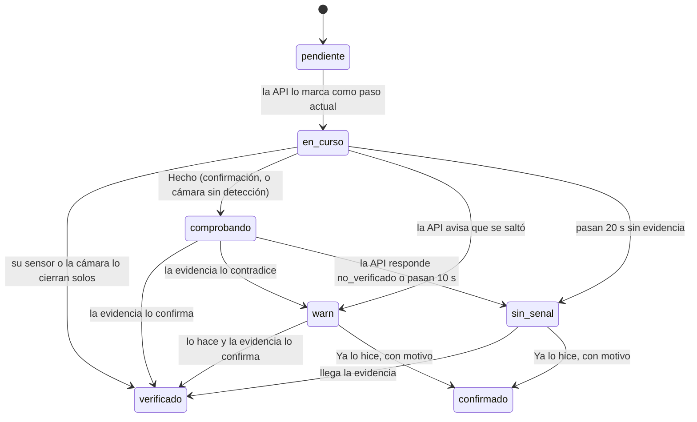

# Frontend — alcance y reparto

**Proyecto:** Factum — Platanus Hack 26
**Rama:** `feat/front-y-servicios`
**Módulo de Diego:** gestión y visualización de órdenes de trabajo (OT)
**Módulo de Dani:** ejecución de la OT, avisos y voz
**Estado:** acordado el 2026-11-21 para el MVP. Sale de la pizarra del equipo y de las respuestas de Dani. Lo marcado *(propuesta)* no se discutió: es una decisión razonable que cualquiera de los dos puede cambiar avisando.

## 1. Para qué

El demo tiene que mostrar esto: el supervisor asigna una OT, el operario la ejecuta paso a paso y, cuando la API detecta que un paso no se hizo, **el operario lo oye en el momento**. A mitad del trabajo cambia el turno y otro operario la termina desde donde quedó.

El front no verifica nada. Muestra lo que decide la API, deja al operario responder y hace sonar el aviso. La lógica de verificación es del equipo de Francisco.

## 2. Decisiones tomadas

| Tema | Decisión |
|---|---|
| Stack | Vite + React + TypeScript, en `web/`. Una sola app con pantallas separadas por ruta, no una sola pantalla. React Router para las rutas, Mantine para los componentes, MSW para el mock y Vitest para los tests |
| Login | Real, con correo y clave contra `POST /auth/entrar` ([ADR-0012](../decisions/0012-login-y-clientes-cada-empresa-ve-lo-suyo.md)). Con mock, además, un toque por persona de prueba |
| Datos mientras no hay back | Un mock que imita la forma que la API ya devuelve (`GET /ot/{id}`), más las extensiones de la [sección 8](#8-contrato-con-la-api). El mock es solo para construir |
| Demo en vivo | Corre sobre el back real, con el supervisor en un computador y el operador en un celular. Los warns y la alerta de seguridad los disparan los sensores reales del ESP32 |
| Captura | El front no captura nada. La cámara y los sensores van por el dispositivo de borde, directo a la API |
| Relevo de turno | Entra al MVP. El reporte final y el conteo de warns por operario quedan en P1 |
| Cuándo actúa el operario | Los pasos se cierran solos con su evidencia: el sensor o la cámara del edge. No hay un «Hecho» permanente. El operario solo actúa cuando la API lo necesita: «Hecho» en un paso que se cierra declarando (confirmación, o cámara sin detección), y «Ya lo hice» cuando la API avisa que el paso se saltó, cuando hay un conflicto o cuando la evidencia no llega (decidido por Dani, 2026-11-21) |
| Botón «Ya lo hice» (el *skip* de la pizarra) | No sirve para saltarse trabajo: el operario lo usa para decir que sí lo hizo, aunque la evidencia no lo muestre. Llama a `POST /ot/{id}/pasos/{paso}/confirmar` con un motivo obligatorio. El paso queda verificado por una persona, a su nombre, y la OT queda en `warning`. No sirve en un paso de confirmación, que se cierra declarando, ni apaga una alerta de seguridad, que se resuelve con el sensor |
| Aviso por voz | Cuando la API avisa que un paso no se hizo, el aviso se convierte en voz con ElevenLabs y suena en la app del operario casi al instante. Ver [sección 7](#7-aviso-por-voz-elevenlabs) |
| Endpoints que faltan | Los hacen Diego y Dani después de las pantallas, como capa de servicios, con lo mínimo. No se invierte tiempo en el back: el equipo de Francisco lo va a cambiar |
| Dispositivo | La app del operario se diseña para celular con audífonos, y el celular queda con la pantalla encendida y la app abierta durante todo el trabajo. La del supervisor se diseña para computador |

**Resuelto con el equipo de Francisco.** Hablar sigue sin cerrar un paso de sensor (regla 2 de `/agente`), pero ahora una persona puede confirmarlo explícitamente, con quién y por qué: `POST /ot/{id}/pasos/{paso}/confirmar` (rama `dreamxist/services`, [LOGICA](./LOGICA.md)). «Ya lo hice» usa ese endpoint.

## 3. Reparto

| Diego — Gestión | Dani — Ejecución |
|---|---|
| Login falso y sesión con rol | Vista de ejecución de la OT |
| Dashboard del supervisor | Máquina de estados del paso |
| Dashboard del operador | Alertas, «Hecho» donde hace falta y «Ya lo hice» |
| Listado y display de OT | Aviso por voz con ElevenLabs |
| Asignar y reasignar operador | Entregar turno y briefing del que llega |
| Estado general de la OT (lo trae la API) | Pantalla de OT completa |
| Escenarios del mock de gestión | Base del mock y escenarios de ejecución |

Dani arma la base compartida de la sección 4 en el primer commit, y Diego parte sobre ella *(propuesta)*.

## 4. Base compartida

```
web/
  src/
    api/         tipos.ts y cliente.ts: el único lugar que sabe de la API
    mocks/       handlers de MSW y escenarios
    sesion/      usuario actual y rol
    gestion/     Diego: login, dashboards, listado
    ejecucion/   Dani: vista de la OT, máquina de estados, voz, briefing
```

| Ruta | Quién entra | Dueño |
|---|---|---|
| `/login` | todos | Diego |
| `/supervisor` | supervisor | Diego |
| `/operador` | operador | Diego |
| `/supervisor/ot/:id` | supervisor | Dani |
| `/ot/:id` | el operador asignado | Dani |

- `api/` y `sesion/` son compartidos: se avisa antes de cambiarlos. Fuera de eso, cada uno trabaja en su carpeta y no hay choques en la rama.
- El id de la OT viaja en la URL y la sesión (`usuario` con `id`, `nombre`, `rol` y empresa, más el `token` y cuándo `expira`) en `localStorage`, aparte con y sin mock. Con eso el módulo de ejecución sabe quién es el actor. Un token vencido o rechazado (401) cierra la sesión y el login dice «Tu sesión venció».
- Los actores usan el formato de la bitácora: `operario:1`, `supervisor:oculta`. El nombre de cada uno sale de la sesión y, para el supervisor, de `GET /cliente/operadores`; si el front no lo conoce, se lee del id («Operario 2»).
- Personas de prueba: las de la minera ficticia Oculta en la semilla del servidor (`datos/ots-semilla.json`): la supervisora Carla Muñoz y los operadores Ana Rojas (`operario:1`) y Bruno Díaz (`operario:2`). El mock usa las mismas, con la clave `demo`; las claves del servidor no van en el repo.
- Con mock, `?como=operario:1` en la URL entra como esa persona sin pasar por el login. Sin mock no hace nada.
- El mock corre en el navegador con MSW, que también imita el WebSocket: `npm run dev:mock` (o `VITE_MOCK=1`). Sin mock (`npm run dev`), el cliente apunta a `VITE_API_URL`, que por defecto es el servidor del equipo, `https://34-176-44-192.sslip.io`, y lo que se toque ahí lo ven todos.
- Dentro de un navegador, el mock es un solo mundo: lo que el supervisor asigna en `/supervisor` aparece en `/operador` y en `/ot/:id`. El escenario solo fija cómo parte ese mundo, y se elige en la URL: `/ot/ot-12?escenario=warn-sobrescrito`. No cruza dispositivos, y no hace falta: el demo corre sobre el back real.
- Los datos del mock usan la pauta real, [`datos/pauta-correa.json`](../../datos/pauta-correa.json): 6 pasos sobre la correa CT-01.

### Colores

Los colores son los de seguridad industrial (ISO 3864, ANSI Z535): los mismos de los letreros y las tarjetas de bloqueo de una planta, así un operario los lee como ya los lee en terreno. Reglas:

- **Cada color significa una sola cosa.** Rojo es peligro, amarillo es precaución, verde es verificado y azul es acción obligatoria, que en la app es el paso actual y el botón «Hecho».
- **Lo demás es neutro.** Una OT tranquila se ve gris y blanca, con el paso actual en azul. Cuando algo sale mal, la pantalla cambia de color, y eso es lo que se tiene que notar.
- **Sin naranjo.** Queda entre el rojo y el amarillo y confunde los dos avisos. Tampoco hay un color de marca aparte.
- **El color nunca va solo.** Siempre va con un ícono y un texto: con sol, con guantes o con daltonismo rojo-verde, el color no alcanza.
- **Fondo claro.** Se lee mejor bajo el sol y en el proyector del escenario.
- **La alerta de capa 1 se ve como una tarjeta de bloqueo:** una franja roja arriba con «Peligro» en blanco, y el cuerpo blanco con el texto en grafito.

| Token | Hex | Uso |
|---|---|---|
| Grafito | `#1F262E` | Texto principal |
| Roca | `#5B6570` | Texto secundario, bordes y pasos pendientes |
| Polvo | `#EDF0F2` | Fondo de la app |
| Blanco | `#FFFFFF` | Superficies: tarjetas, banner, barra inferior |
| Acción | `#004C97` | Paso actual, «Hecho» y botones principales |
| Verificado | `#00843D` | Paso verificado |
| Precaución | `#FFD100` de relleno, `#7A5C00` para texto | Avisos de nivel `warning` (cámara y anomalías de señal), sin señal, sin conexión y la marca de un paso confirmado por una persona |
| Peligro | `#C8102E` | Lo de nivel `error`: el warn de capa 1 que suena y la alerta de seguridad |

El amarillo de seguridad no se lee como texto sobre blanco (1,5:1): va siempre de relleno con texto grafito (10,5:1), y el texto amarillo usa `#7A5C00` (6,3:1). Los demás pasan AA con texto blanco: rojo 5,9:1, verde 4,8:1, azul 8,5:1.

**Ejecución:** `pendiente` roca · `en_curso` y `comprobando` acción · `verificado` verificado · `warn` peligro si es capa 1 y precaución si no · `sin_senal` precaución · `confirmado` verificado con un borde izquierdo de precaución, porque está cerrado pero cuenta como warn.

**Gestión:** `sin_asignar` roca · `asignada` y `en_ejecucion` acción · `entregada` precaución, porque espera al supervisor · `completa` verificado.

El tema vive en `web/src/tema.ts` y nadie escribe un hex fuera de ahí:

```ts
import { createTheme, type MantineColorsTuple } from '@mantine/core'

const accion: MantineColorsTuple = ['#ebf1f7', '#d1dfec', '#adc6de', '#85a9cd', '#5c8cbc', '#2e6caa', '#004C97', '#004180', '#00356a', '#002a53']
const verificado: MantineColorsTuple = ['#ebf5ef', '#d1e9dc', '#add8c1', '#85c4a2', '#5cb083', '#2e9a60', '#00843D', '#007034', '#005c2b', '#004922']
const precaucion: MantineColorsTuple = ['#fffbeb', '#fff7d1', '#fff0ad', '#ffe985', '#ffe25c', '#ffd92e', '#FFD100', '#d9b200', '#b29200', '#7A5C00']
const peligro: MantineColorsTuple = ['#fbecee', '#f5d4d9', '#edb3bc', '#e58c9b', '#dc6679', '#d23b54', '#C8102E', '#aa0e27', '#8c0b20', '#6e0919']
const roca: MantineColorsTuple = ['#f2f3f4', '#e1e3e5', '#cbced1', '#b0b5ba', '#969ca3', '#79818a', '#5B6570', '#4d565f', '#40474e', '#32383e']

export const tema = createTheme({
  primaryColor: 'accion',
  primaryShade: 6,
  colors: { accion, verificado, precaucion, peligro, roca },
  black: '#1F262E',
  white: '#FFFFFF',
  autoContrast: true, // texto grafito sobre el amarillo, blanco sobre los demás
})
// El fondo Polvo (#EDF0F2) va en el body, con forceColorScheme="light" en el MantineProvider.
```

## 5. Diego — gestión

**Login.** Correo y clave; al entrar va a su dashboard según el rol, y el encabezado dice su nombre y su empresa. Si la clave no calza lo dice ahí mismo; si el servidor no responde, también. Con mock, abajo hay un toque por persona de prueba.

**Pedir OT.** El supervisor elige una de las pautas de su empresa y la OT aparece por asignar, con un aviso de cuál pidió.

**Verificación.** Cada OT de la lista dice cómo va lo que Factum verifica: «Todo bien», «Atención» o «Detente», con ícono y texto. Sale de `GET /cliente/ots/{id}`: las OT en ejecución se piden en cada recarga, las demás solo cuando cambia su resumen, y las sin asignar no se califican.

**Incidentes.** Una OT abierta en «Detente» es un incidente. Arriba de la lista aparece una barra roja con cada uno (OT, operador y el motivo más grave) y «Ver en vivo». Cuando aparece uno nuevo suena una campana corta (Web Audio, sin archivos); los que ya estaban al entrar no suenan. El supervisor solo mira: no confirma ni detiene nada.

**Vista en vivo (`/supervisor/ot/:id`).** Se llega desde la barra, desde el id de la OT o desde «Ver». Arriba, las alertas abiertas en rojo, con «Ver en la bitácora». A un lado, la cámara de la estación (`GET /edge/{edge}/video.mjpg`, el video que el edge manda al servidor) y los sensores, con el que espera el paso en curso marcado; si la OT no corre en una estación, lo dice. Al otro, los pasos y la bitácora completa, lo último arriba. Todo llega por el mismo WebSocket de la OT que usa la ejecución, pero esta vista no abre sesión ni declara: mirar no cambia la bitácora.

**Supervisor.** Ve todas las OT con su estado general, su operador y su avance. Asigna las que no tienen operador y reasigna las entregadas. Reasignar es P0: sin eso no hay relevo.

**Operador.** Ve solo sus OT y entra a una con «Comenzar» o «Continuar», que lleva a `/ot/:id`.

**Cada OT muestra:** id, nombre de la pauta, equipo, operador, estado general, avance (por ejemplo 3/6) y la acción según el rol. El avance y el estado los trae la API: el front no los calcula.

Estados generales *(propuesta)*:

| Estado | El supervisor ve | El operador ve |
|---|---|---|
| `sin_asignar` | «Asignar» | no aparece |
| `asignada` | el operador | «Comenzar» |
| `en_ejecucion` | el operador y el avance | «Continuar» |
| `entregada` | «Reasignar», con el avance y quién la entregó | ya no le aparece al que la entregó |
| `completa` | el avance final | «Ver resumen» |

## 6. Dani — ejecución

### La pantalla

```
┌──────────────────────────────┐
│ ← Mis OT          Factum OP1 │
├──────────────────────────────┤
│ OT-12 [Peligro]          0/6 │
│ Cambio de rodillo      00:04 │
│ ▬▬▬▬▬▬▬▬▬▬▬▬▬▬▬▬▬▬▬▬▬▬▬▬▬▬▬▬ │
├──────────────────────────────┤
│ ┃ Paso saltado               │
│ ┃ Hiciste «Retirar la guarda»│
│ ┃ antes de «Cortar la…».     │
│ ⚠ 1 Cortar energía y bloquear│
│   Te saltaste este paso…     │
│   [ Ya lo hice ]             │
│ · 2 Retirar la guarda        │
│ · 3 Cambiar el rodillo       │
│ ──────────────────────────── │
│ [       Entregar turno     ] │
└──────────────────────────────┘
```

No hay un «Hecho» fijo abajo. El paso actual dice cómo se cierra: «Se cierra solo cuando el sensor lo marque», «…cuando la cámara lo vea», o un botón «Hecho» si es de los que se cierran declarando. Si la cámara del edge manda detecciones, el paso de cámara en curso muestra qué ve ahora.

### Estados de un paso



| Estado en pantalla | De dónde sale | Qué puede hacer el operario |
|---|---|---|
| `pendiente`, `en_curso` | `no_verificado` en la API; es `en_curso` si es el `paso_actual` | Nada si se cierra solo; «Hecho» si se cierra declarando |
| `comprobando` | Solo del front: tocó «Hecho» y espera la respuesta | Nada |
| `warn` | `en_conflicto` en la API, o una alerta de orden activa cuyo `evidencia.pendiente` es este paso | Hacerlo, o «Ya lo hice»; en un paso de cámara sin detección, también «Hecho» de nuevo |
| `sin_senal` | Solo del front: la evidencia no llega (20 s esperando, o `declarar` respondió `no_verificado`) | «Ya lo hice» |
| `verificado` | `verificado` en la API, con evidencia de sensor o cámara | Nada; dice «por sensor» o «por la cámara» |
| `confirmado` | `verificado` en la API con `evidencia.tipo = persona` | Nada; dice «Confirmado por OP1: «motivo»» |

- **La API manda.** El front nunca cierra un paso ni decide el orden: muestra el `paso_actual` que le llega. Cuando el stream trae un `evento` con `paso_id`, el front vuelve a pedir `GET /ot/{id}`.
- **Cuándo un paso se cierra solo** (`web/src/api/pauta.ts`): si es de sensor, o de cámara con `deteccion`. La pauta LOTO del demo se cierra entera sola; en la de la correa, «Hecho» aparece en el paso de cámara sin detección y en el de confirmación.
- «Hecho» llama a `POST /ot/{id}/declarar` con el `paso_id` que la pantalla mostraba.
- «Ya lo hice» pide un motivo (con atajos de un toque: «El sensor no lo marca», «La cámara no lo ve», «Lo revisé en persona») y llama a `POST /ot/{id}/pasos/{paso}/confirmar`. No aparece en un paso de confirmación.
- En `sin_senal` el front no inventa un warn ni lo hace sonar: solo ofrece confirmarlo.
- Sin conexión, los botones que escriben se deshabilitan.

### Alertas

Llegan en cualquier momento, vaya el operario en el paso que vaya. Se ven arriba de los pasos y dicen qué clase de alerta son (por su `evidencia.clave` en la API: `seguridad:`, `orden:`, `control:`, `senal:`):

| Alerta | Se ve | Se apaga |
|---|---|---|
| Seguridad («Guarda abierta con energía viva») | Tarjeta de bloqueo roja: «Peligro» | Sola, con un `alerta_resuelta` cuando el sensor se corrige. Confirmar a mano no la apaga |
| Orden («ORDEN INVERTIDO…») | Tarjeta roja: «Paso saltado», con qué se hizo antes de qué | Haciendo el paso saltado, o confirmándolo con «Ya lo hice» en el paso |
| Control perdido | Tarjeta roja: «Control perdido», con el paso que se deshizo | Sola, cuando el sensor vuelve |
| Señal (capa 2) | Franja amarilla: «Precaución» | Sola |

El banner no tiene botones: informa. Lo que el operario puede hacer está en el paso. Muestra las `alertas_activas` del snapshot, más cada evento `alerta` nuevo, menos las que cierra un `alerta_resuelta` (por su `evidencia.resuelve`). `calificacion.nivel` pinta el indicador general de la OT.

### Qué suena y qué no

Suena, y aparece en grande sobre la pantalla, lo que llega con nivel `error`, y solo la capa 1 (sensores y reglas) llega a `error`: un salto, un control perdido, una alerta de seguridad. Un salto y un control perdido suenan siempre, aunque la API los calificara más bajo: es el aviso que pidió el equipo. Lo que dice la cámara (capa 3) y las anomalías de señal (capa 2) llegan a lo más a `warning`: se muestran en su paso pero no suenan, como fija [LOGICA](./LOGICA.md#qué-puede-interrumpir-al-operario). Con tantas falsas alarmas, un aviso que suena de más le enseña al operario a ignorarlo.

### Relevo de turno

1. OP1 toca «Entregar turno» (al final de la lista) y confirma. El front llama a `POST /ot/{id}/relevo/entregar` y vuelve a `/operador`.
2. El supervisor reasigna la OT a OP2 (Diego).
3. OP2 entra y ve el **briefing** antes de la ejecución: el resumen, qué pasos están cerrados y cómo (por sensor, por la cámara, o confirmado por quién), los avisos heredados y desde qué paso sigue. Hay un relevo pendiente si el último `relevo_entregado` de la bitácora no tiene un `relevo_recibido` después, y el resumen viene en su `detalle`.
4. OP2 toca «Recibido». El front llama a `POST /ot/{id}/relevo/recibir` y abre la ejecución en el paso actual.

### Navegación

Todas las pantallas de una OT tienen arriba «← Mis OT», para volver a la lista sin entregar el turno. Una OT completa muestra el cierre con «Volver a mis OT»; una que no existe lo dice y ofrece lo mismo. Una ruta desconocida lleva al inicio del rol, o al login.

### OT completa

Pantalla de cierre con los pasos verificados, los confirmados por una persona y los avisos. El reporte con KPIs de desempeño es P1.

### Si la API falla

Banner «Sin conexión, reintentando». Se mantiene el último estado conocido, los botones que escriben se deshabilitan y el WebSocket reintenta con espera creciente, volviendo con `?desde=`. Si vuelve la red, o la pantalla vuelve después de 10 s oculta, reconecta al tiro.

Un 409 trae en `regla` la regla de negocio que se violó: se le muestra al operario tal cual y no se reintenta igual.

## 7. Aviso por voz (ElevenLabs)

Cuando la API avisa que un paso no se hizo, el aviso se convierte en voz con ElevenLabs y suena en la app del operario casi al instante.

**Cómo llega:**

1. Al tocar «Comenzar» o «Continuar», el front abre la sesión (`POST /ot/{id}/sesion`) y se conecta a `wss://…/ot/{id}/stream`. Solo escucha. Si se corta, vuelve con `?desde=<último evento.id>`.
2. Suena un `evento` nuevo cuya `calificacion.nivel` es `error` (seguridad, un conflicto de sensor) y **siempre** una alerta de paso saltado (`orden`) o de paso que se deshizo (`control`), aunque la API la calificara más bajo. La duda de la cámara no suena: se ve en su paso. El front arma la frase y pide su audio a `GET /api/voz?texto=…`. Si el audio no empieza en 2,5 s, lo dice la voz del navegador.
3. Lo que suena **también aparece en grande** sobre la pantalla: la misma frase, el título de la alerta («Paso saltado», «Peligro», «Control perdido»), qué hacer, «Entendido» y «Escuchar de nuevo». Con guantes y ruido de planta el operario puede no oírlo, y en el celular el banner queda fuera de la vista si bajó por la lista. Al tocar «Entendido» la pantalla va al paso afectado. Se cierra solo si la alerta se resuelve o el paso queda verificado; el banner y el paso siguen mostrando la alerta mientras esté activa.
4. El `evento.id` es la llave: un evento suena y aparece una sola vez, también al reconectar. La bitácora que trae el snapshot al conectar **no** suena ni aparece: es lo que ya pasó.
5. `/api/voz` es nuestro, no de la API de Francisco: lo sirve el mismo servidor del front (`web/servidor/voz.ts`, montado en `vite.config.ts`; al desplegar, una función de Vercel con el mismo código). Hace la misma llamada que `~/code/Godoy97/elevenlabs-tts/tts.py`, con `eleven_flash_v2_5` y la voz «George» (`ELEVENLABS_VOICE_ID` para otra). Cada frase se genera una vez y se guarda en `web/.cache/voz/`.

**Cómo correrlo:** la llave va en `web/.env.local` (git la ignora) como `ELEVENLABS_API_KEY=…`, y `npm run dev:mock` (o `npm run dev`) ya sirve la voz. Sin llave, `/api/voz` responde 503 y el aviso lo dice el navegador.

Por qué la voz sale del evento y no de `calificacion.avisos`: un aviso no trae `id` ni dice de qué paso es, así que no hay cómo saber si ya sonó. Y por qué el front pide la voz en vez de esperar que el back la adjunte: así la voz solo necesita un texto, y no depende de cómo el equipo de Francisco rehaga los eventos. Si después el back manda un `audio_url`, el front reproduce ese.

**Reglas:**

- La llave de ElevenLabs vive solo en el servidor, en `ELEVENLABS_API_KEY`, sin prefijo `VITE_`: así Vite nunca la manda al navegador. Nunca en el repo: el repo es público. `/api/voz` no tiene autenticación, así que genera a lo más 200 frases nuevas por arranque; las guardadas se sirven siempre.
- Meta: menos de 2 s desde que el evento entra a la bitácora hasta que suena *(propuesta)*. El stream lo entrega al instante, así que casi todo ese tiempo es de ElevenLabs.
- Los textos de los avisos del demo se generan una vez y se guardan, para que en el escenario suenen sin esperar a ElevenLabs.
- Si `/voz` falla, el front dice el mismo texto con la voz del navegador (`speechSynthesis`). El aviso nunca queda mudo.
- Si llegan dos eventos, suenan en orden, sin pisarse.
- Lo que se dice es una frase armada en el front (`textoParaVoz`), con el tono de la pizarra: un salto suena «Oye, te saltaste el paso 1: Cortar la energía y bloquear con candado. Hazlo antes de seguir.»; un control perdido, «Oye, se deshizo el paso 1: …»; lo demás, el `detalle` de la API sin las mayúsculas gritadas.
- El navegador del celular no reproduce sonido hasta que el usuario toca algo. El toque en «Comenzar» o «Continuar» desbloquea el audio: Diego llama a `desbloquearAudio()` de `web/src/ejecucion/voz.ts` en ese botón. Si se entra a `/ot/:id` sin ese toque (una recarga o un enlace directo), la pantalla pide un toque antes de empezar. Muestra si el audio está activo, con un botón «Probar audio». Probarlo en el celular del demo, sobre todo si es iPhone.
- Con la pantalla bloqueada, el celular corta el WebSocket y deja de sonar. La vista de ejecución le pide al navegador que mantenga la pantalla encendida (Wake Lock API) mientras la OT está abierta.
- Con el mock la voz es la misma: `/api/voz` la sirve el servidor del front, no la API.

## 8. Contrato con la API

> El back va a cambiar con el equipo de Francisco. Esto es solo lo que el front consume, y todo cambio se absorbe en `web/src/api/` sin tocar las pantallas.

La API está desplegada en `https://34-176-44-192.sslip.io`. La guía completa está en [`/agente`](https://34-176-44-192.sslip.io/agente), los esquemas en `/openapi.json`, y el diseño en el [PRD de servicios en vivo](../projects/servicios-en-vivo/PRD.md), el [ADR-0007](../decisions/0007-servicios-en-vivo-sesion-stream-y-calificacion.md) y el [ADR-0012](../decisions/0012-login-y-clientes-cada-empresa-ve-lo-suyo.md). Las listas y la asignación van por el servicio para clientes, con login; la ejecución de una OT (`/ot/{id}/...`) sigue abierta. El front manda el token en todas las llamadas.

**Lo que el front usa y ya existe:**

| Qué | Para | Nota |
|---|---|---|
| `POST /auth/entrar` `{usuario, clave}` → `{token, expira, persona}` | los dos | `persona`: `{id, nombre, usuario, rol, cliente}`. El token dura 12 horas y va como `Authorization: Bearer`. 401 si no calzan. `POST /auth/salir` lo invalida |
| `GET /cliente/ots` → `[{ot, pauta, version, equipo, abierta_en, paso_actual, completa, operador, estado_general, entregada_por, cerrados, total}]` | Diego | El supervisor ve todas las de su empresa; el operador, las suyas. El id viene en `ot`, no en `id`. El avance es `cerrados` sobre `total`, sin pedir cada OT. 401 sin token |
| `GET /ot/{id}` → `{pauta, equipo, paso_actual, completa, pasos, verificados, en_conflicto, pendientes}` | los dos | Cada paso: `id, orden, titulo, estado, control_critico, capa, evidencia, detalle`. El dashboard del operador lo pide solo para sus OT abiertas, para mostrar en qué paso siguen |
| `GET /cliente/pautas` → `[{id, nombre, version, equipo, pasos, protocolos}]` | Diego | Las pautas que la empresa puede pedir: su nombre legible para la lista de OT y las opciones de «Pedir OT» |
| `GET /cliente/operadores` → `[persona]` | Diego | Los operadores de la empresa, para asignar y para sus nombres. Solo supervisor (403) |
| `POST /cliente/ots` `{pauta_id}` → `{ot, pauta, version, nombre, cliente}` | Diego | «Pedir OT»: la OT nace sin operador. Solo supervisor; 403 si la pauta no está habilitada para su empresa |
| `GET /pautas/{pauta_id}?version=` | Dani | La pauta completa, con `instruccion`, `tipo_evidencia` y `deteccion` de cada paso: con eso se sabe si un paso se cierra solo. Se pide una vez |
| `POST /cliente/ots/{id}/asignar` `{operador}` | Diego | Asigna una OT sin operador o reasigna una entregada. Quién asigna sale del token y queda en la bitácora como `ot_asignada`. 403 si el operador no es de la empresa; 409 si está completa o ya tiene operador |
| `POST /ot/{id}/sesion` `{edge_id, operario}` | Dani | Une la OT con el edge. Sin sesión, las lecturas no llegan a ninguna OT. El demo tiene un solo edge, `edge-1`, que va en `VITE_EDGE_ID` |
| `WS /ot/{id}/stream?desde=` | Dani | Primero un `snapshot` (estado, calificación, alertas activas, sesión, sensores y bitácora) y después `lectura`, `evento`, `calificacion_ot`, `sesion` y `detecciones` (lo que ve la cámara del edge) |
| `POST /ot/{id}/declarar` `{actor, texto, paso_id}` | Dani | «Hecho». `paso_id` es el paso que la pantalla mostraba: si su evidencia ya lo cerró, no se evalúa el siguiente. Un paso de cámara se juzga con el último cuadro del edge |
| `POST /ot/{id}/pasos/{paso_id}/confirmar` `{actor, motivo}` | Dani | «Ya lo hice». Solo el paso en curso, nunca uno de confirmación, nunca sin motivo (409). Deja un `veredicto` `verificado`, capa nula, con `evidencia: {tipo: persona, motivo, contra}` |
| `POST /ot/{id}/relevo/entregar?actor=` y `/relevo/recibir?actor=` | Dani | El relevo pendiente se lee de la bitácora (sección 6) |
| `GET /edge/{edge_id}/video.mjpg` | Diego, P1 | Video en vivo en un ``, por si el supervisor quiere ver la estación. Ya existe una página `/monitor` con video, avisos y bitácora |

Un aviso de `calificacion.avisos` es `{nivel, certeza, capa, motivos}`: sin `id` y sin `paso_id`. Un `evento` del stream trae `id, tipo, paso_id, estado, capa, detalle, evidencia, calificacion`.

**La voz no es de esta API:** `GET /api/voz` la sirve el servidor del front (sección 7). El servidor de Francisco no necesita la llave de ElevenLabs.

Respaldo si el ESP32 falla en el escenario: la lectura se puede escribir a mano en `POST /edge/edge-1/lecturas` o en `POST /sensores`.

`GET /cliente/ots/{id}` trae la OT con su `calificacion` (todo bien, atención o detente). El front la usa para la verificación de la lista, para los incidentes y para saber si una persona puede abrir una OT: responde 404 si no es de su empresa o, para un operador, si no está asignada a él. Con 404 la ejecución dice «Esta OT no está en tu lista» y no abre sesión.

`GET /edge/{edge_id}/video.mjpg` es el video en vivo de la estación, para un ``. `POST /ot/{id}/sesion` responde 401 `{clave}` si la estación ejecuta otra OT: quitársela pide `X-Clave-Equipo`. El front no manda esa clave (iría en el navegador, a la vista); dice que la estación está ocupada y reintenta.

## 9. Escenarios del mock

Ejecución (Dani). Todos sirven para las dos pautas del repo: la correa (por defecto) y LOTO, la del demo con ESP32 y cámara (`?pauta=loto`).

| Escenario | `?escenario=` | Qué hace la API |
|---|---|---|
| Camino feliz | `feliz` | Los pasos de sensor (4 s) y de cámara con detección (5 s) se cierran solos; «Hecho» cierra los demás; la OT termina |
| Salto corregido | `warn-corregido` | Al llegar al primer control crítico, la API avisa que se saltó (un paso posterior se hizo antes); 5 s después el operario lo hace y el aviso se resuelve solo |
| Salto confirmado | `warn-sobrescrito` | El mismo salto, pero nada lo cierra hasta que el operario toca «Ya lo hice» con un motivo |
| Alerta de seguridad | `alerta-seguridad` | La guarda se abre con energía viva a mitad del trabajo; se resuelve sola 10 s después |
| Control perdido | `control-perdido` | El primer control crítico ya verificado se deshace y vuelve 8 s después |
| La cámara dice que no | `camara-no` | El primer «Hecho» en un paso de cámara da un conflicto que se muestra pero no suena |
| Sin evidencia | `sin-senal` | Nada se cierra solo: a los 20 s el paso ofrece «Ya lo hice» |
| Relevo | `relevo` | OT en 3/6 con un paso confirmado por Ana; Bruno entra y la termina |
| Incidente | `incidente` | Para el supervisor: la OT de Bruno va en la estación y a los 8 s se abre la guarda con la energía viva. Barra roja, campana y vista en vivo. `/supervisor?escenario=incidente&como=supervisor:oculta` |
| API caída | `api-caida` | Errores y timeouts con el operario a mitad de un paso |
| Ya completa | `completa` | La OT está terminada cuando el operario la abre |

Gestión (Diego):

| Escenario | `?escenario=` | Qué hace la API |
|---|---|---|
| Lista vacía | `vacia` | No hay OT |
| Lista mixta | `mixta` | OT en todos los estados generales |
| OT ya tomada | `ya-asignada` | Al asignar, responde que otro supervisor ya la asignó (409) |
| OT ajena | `?como=operario:1` en `/ot/ot-13` | Un operador abre por URL una OT que no es suya: «Esta OT no está en tu lista» (404) |

## 10. Prioridades

### P0

**Diego**
- [ ] Login falso con roles.
- [ ] Dashboard del supervisor.
- [ ] Dashboard del operador.
- [ ] Listado y display de OT.
- [ ] Asignar y reasignar operador.
- [ ] Navegación a `/ot/:id`.
- [ ] Escenarios de gestión.

**Dani**
- [ ] Base compartida y mock.
- [ ] Vista de ejecución con la máquina de estados.
- [ ] Alertas, «Hecho» donde hace falta y «Ya lo hice» con motivo.
- [ ] Voz: `/voz` con ElevenLabs y reproducción en el celular.
- [ ] Entregar turno y briefing.
- [ ] Pantalla de OT completa.
- [ ] Escenarios de ejecución.

**Los dos, después de las pantallas:** lo que falta de la sección 8 (asignar y voz), lo mínimo para que el demo corra contra el back real. Es camino crítico, porque el demo no corre sobre el mock: tiene que estar listo con tiempo para ensayar, a más tardar a las 05:00 del domingo 2026-11-22 *(propuesta)*.

### P1

- [ ] Reporte final con KPIs de desempeño (Dani).
- [ ] Warns por operario en el dashboard del supervisor, el «OP1 +1 warn» de la pizarra (Diego).
- [ ] Durante la ejecución: notas, reportar una anomalía y pedir apoyo al supervisor (Dani).
- [ ] Filtros y búsqueda de OT (Diego).
- [ ] Panel para disparar a mano los eventos del mock en el ensayo (Dani).
- [x] Login real, contra `POST /auth/entrar`.
- [ ] Estados vacíos y mensajes de error más cuidados.

## 11. Criterio de éxito

En el escenario corre sobre el back real, con el supervisor en un computador, el operador en un celular y los sensores reales del ESP32. Antes de eso, cada paso se prueba sobre el mock.

1. El supervisor entra y asigna la OT a OP1.
2. OP1 entra, ve solo sus OT y comienza.
3. Un sensor muestra que un paso no se hizo, la API avisa y OP1 lo oye en menos de 2 s.
4. OP1 toca «Ya lo hice» con un motivo y el paso queda confirmado a su nombre.
5. Alguien abre la guarda con la energía viva y suena la alerta de seguridad.
6. OP1 entrega el turno y el supervisor reasigna a OP2.
7. OP2 lee el briefing, confirma y termina la OT.

## 12. Enfoques considerados

| Tema | Elegido | Descartado y por qué |
|---|---|---|
| Stack | Vite + React + TS, una app con rutas | Next.js: más pesado de montar, y el render en servidor no le aporta nada al demo. HTML plano en `app/estatico`: sin build, pero difícil de trabajar entre dos y de probar una máquina de estados |
| Forma del mock | La del esqueleto más extensiones | `{bool, string}` de la pizarra: no distingue un warn de una alerta crítica ni muestra la evidencia. Modelo propio con adaptador: más aislado del back, pero más código, y `api/` ya hace de adaptador |
| Componentes | Mantine, sin Tailwind | MUI: más pesado, y cuesta que no se vea como Material. shadcn/ui con Tailwind: se ve muy bien, pero cada componente se copia y se arma a mano, y dos personas agregando a la misma carpeta chocan |
| Origen de la voz | El front pide el audio a `/voz` | Que el back adjunte el audio al warn: ata la voz a cómo el equipo de Francisco rehaga los warns. ElevenLabs desde el navegador: expone la llave en un repo público |

## 13. Queda a criterio de quien construye

- La tipografía y el resto del tema de Mantine. Los colores están fijos en la [sección 4](#colores).
- Cómo se implementa la máquina de estados. Sugerencia: un reducer puro y tipado, probado con Vitest, sin librerías.
- Cómo guarda el mock su estado entre llamadas.
- Cómo se desbloquea el audio en cada navegador.
- Dónde se publica el front.
